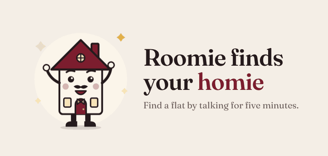
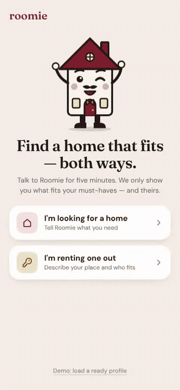

<p align="center">
  
</p>

Built in three hours at a hackathon whose challenge was to help someone take a concrete step on the housing problem.

<p align="center">
  
</p>

## The problem

Looking for a flat in Barcelona means writing to every listing you see. At first you are picky; after a month you message everything, hoping someone calls back.

It is no better on the other side. Around 95 people write to each rental listing in Barcelona (idealista, April to June 2026). Nobody can read 95 messages, so the landlord answers a few and ignores the rest, sometimes two months later, when you already have a home.

People want flats and landlords want tenants. What fails is how they find each other.

## How Roomie works

1. **You talk to an agent.** First you say what you offer, then what you are looking for. For every condition, the agent asks whether it is a must or just a preference.
2. **The landlord does the same interview** about the home. That conversation is the listing; nobody writes one.
3. **Your feed only shows homes where both sides meet each other's musts.** Preferences and anything else you said decide the order.
4. **You like a home, the landlord likes you back,** and you both see why you match. Nobody had to write a single message.

Musts are checked in code, over a fixed set of fields, never by a model. The language model only fills those fields from the conversation, and the free text only changes the order. Fields like age, nationality, gender or children do not exist: the agent never asks for them, because filtering by them is illegal discrimination in renting.

## The catch

If homes are only ordered by fit, the same five flats come first for everyone, and those five landlords are back to 95 messages while the rest are never seen.

So the idea is that every home has a limit on how many people see it at the same time. When a home is full, the next person gets their next best one, and a place opens again when someone passes. It is the same problem as placing medical graduates in hospitals, which is solved with the matching method that won the 2012 Nobel Prize in Economics.

We pitched this part in the hackathon; the app itself shows each person their five best compatible homes.

## Built with

- **Voice interview:** OpenAI Realtime (`gpt-realtime`), with tool calls that save each fact and requirement as it is said
- **Matching:** a mutual filter on musts, then ordering by preferences and by embeddings of the free text (`text-embedding-3-small`)
- **App:** Next.js, React and SQLite, shown as a phone-sized web app

## Run it

```bash
npm install
cp .env.example .env.local   # add your OpenAI API key
npm run seed                 # load the sample homes and tenants
npm run dev                  # http://localhost:3000
```

```bash
npm test
```

---

Built by Adolfo, Asier and Ander. Home photos from [Unsplash](public/homes/CREDITS.md).
