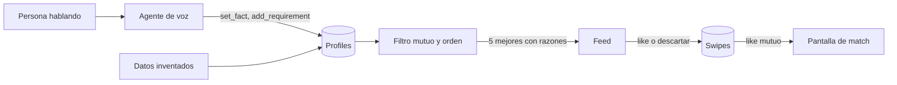

# Diseño del sistema: matching de vivienda por voz

Parte del spec en `docs/1-spec.md`. Los identificadores van en inglés.

Una sola aplicación web, tres partes con dueño y un contrato de datos que las une. Si fijamos el
contrato en la primera media hora, los tres trabajamos en paralelo sin esperarnos.

## Cómo encaja todo

La entrevista produce un `Profile`. El matching lee perfiles y devuelve un feed. La interfaz enseña
el feed y registra los likes. Ninguna parte necesita saber cómo funciona otra por dentro; solo la
forma del `Profile` y seis rutas.



## El contrato: un perfil con hechos y requisitos (los tres)

Inquilino y casa usan la misma estructura. Cada perfil tiene **hechos** (lo que ofrece, la fase 2
de la entrevista) y **requisitos** (lo que busca, la fase 1). Un requisito es una condición sobre
un hecho del otro lado, marcada como imprescindible o preferencia.

```ts
// src/domain/profile.ts
type Role = "tenant" | "home";

type District =
  | "ciutat_vella" | "eixample" | "sants_montjuic" | "les_corts"
  | "sarria_sant_gervasi" | "gracia" | "horta_guinardo"
  | "nou_barris" | "sant_andreu" | "sant_marti";

type EmploymentContract =
  | "permanent" | "temporary" | "self_employed" | "student" | "unemployed";

interface TenantFacts {
  monthlyIncomeEur: number;
  employmentContract: EmploymentContract;
  occupants: number;
  hasPets: boolean;
  smokes: boolean;
  moveInDate: string;   // ISO date
  stayMonths: number;
}

interface HomeFacts {
  monthlyRentEur: number;
  district: District;
  rentalType: "entire_home" | "room";
  bedrooms: number;
  sizeM2: number;
  furnished: boolean;
  availableFrom: string; // ISO date
}

interface Requirement {
  field: string;                       // a key of the other side's facts
  operator: "eq" | "lte" | "gte" | "in";
  value: string | number | boolean | string[];
  isMust: boolean;
}

interface Profile {
  id: string;
  role: Role;
  displayName: string;                 // person name or home title
  photoUrls: string[];
  facts: TenantFacts | HomeFacts;
  requirements: Requirement[];
  notes: string;                       // answer to "¿quieres añadir algo?"
  status: "draft" | "complete";
}

interface FeedItem {
  profile: Profile;
  score: number;                       // 0..1
  reasons: string[];                   // ready to show, in Spanish
}
```

La versión que manda es `src/domain/profile.ts`, escrita como esquemas zod. Afina dos cosas sobre
este bloque: `facts` admite campos sin rellenar mientras dura la entrevista, y el `field` de un
requisito solo acepta hechos del otro rol (un inquilino no puede pedir nada sobre `hasPets`).

Ejemplo: el casero pide contrato indefinido y sin mascotas, y lo marca como imprescindible.

```json
[
  { "field": "employmentContract", "operator": "in", "value": ["permanent"], "isMust": true },
  { "field": "hasPets", "operator": "eq", "value": false, "isMust": true },
  { "field": "stayMonths", "operator": "gte", "value": 12, "isMust": false }
]
```

- No hay campos de nacionalidad, edad, género ni hijos. Como el filtro solo puede leer estos
  campos, nadie puede descartar por lo que no está.
- "A 10 minutos de mi universidad" se convierte en una lista de distritos: `district in [...]`.
- Los hechos son obligatorios: la entrevista no termina hasta tenerlos todos. Los requisitos son
  opcionales.

## La regla de match (Asier)

1. **Filtro.** Una pareja inquilino-casa pasa solo si los hechos de la casa cumplen todos los
   imprescindibles del inquilino y los hechos del inquilino cumplen todos los imprescindibles de
   la casa. Lo hace el código, sin modelo.
2. **Orden.** Entre las que pasan: `score = 0.7 × preferencias cumplidas + 0.3 × parecido de las
   notas`. Las preferencias cuentan en los dos sentidos; el parecido es el coseno entre los
   embeddings de las dos `notes`.
3. **Feed.** Las 5 de mayor score que esa persona aún no ha deslizado.
4. **Razones.** Frases generadas por plantilla a partir de los requisitos cumplidos ("Cumple tu
   máximo de 900 €", "Tienes el contrato indefinido que pide"). Sin modelo: son rápidas y no pueden
   inventarse nada.

Los pesos 0.7 y 0.3 son un punto de partida; se ajustan mirando el feed con los datos inventados.

## Las rutas

| Ruta | Qué hace | Devuelve | Dueño |
|---|---|---|---|
| `POST /api/voice/token` | Pide a ElevenLabs un token de conversación para que el navegador abra la sesión de voz | token temporal | Adolfo |
| `POST /api/profiles` | Crea un perfil en borrador para un rol | `Profile` | Asier |
| `PATCH /api/profiles/:id` | Guarda hechos, requisitos o notas según llegan de la entrevista; al completar, calcula el embedding de las notas | `Profile` | Asier |
| `GET /api/feed?profileId=` | Aplica filtro y orden | `FeedItem[]` (máx. 5) | Asier |
| `POST /api/swipes` | Registra like o descarte; comprueba si el otro ya dio like | `{ match: FeedItem \| null }` | Asier |
| `GET /api/matches?profileId=` | Matches de un perfil; la interfaz la consulta cada 2 segundos para avisar al otro lado | `FeedItem[]` | Asier |

Todo lo que entra por una ruta se valida contra el esquema antes de guardarse, también lo que manda
el agente de voz: la salida de un modelo es entrada no fiable.

## La entrevista de voz (Adolfo)

- La voz va con la plataforma de agentes de ElevenLabs. El navegador se conecta con su SDK de
  JavaScript (`@elevenlabs/client`) por WebRTC. El servidor pide a ElevenLabs un token de
  conversación y se lo pasa al navegador; la clave de ElevenLabs nunca sale del servidor.
- Dos agentes creados en ElevenLabs, uno por rol, con las mismas tres herramientas de cliente:
  `set_fact(field, value)`, `add_requirement(field, operator, value, isMust)` y
  `finish_interview(notes)`. Se declaran en la configuración del agente y se implementan en el
  navegador con el mismo nombre. Cada llamada hace un `PATCH` al perfil y la pantalla enseña el
  campo rellenándose mientras la persona habla.
- Guion de cada agente. Fase 1: qué buscas, y tras cada cosa, "¿es imprescindible?". Fase 2: qué
  ofreces, hasta completar todos los hechos. Cierre: "¿quieres añadir algo?".
- El agente no pregunta por nacionalidad, edad, género ni hijos, y si alguien lo dice no hay
  herramienta donde guardarlo.
- **Plan B si falla la voz en directo:** la misma conversación en modo solo texto, que el SDK
  admite con el mismo agente y las mismas herramientas, y un perfil de demo ya entrevistado que se
  carga con un botón.
- OpenAI sigue en el proyecto: los embeddings de las notas (`text-embedding-3-small`) y, si se
  elige así en ElevenLabs, el modelo de lenguaje que hay detrás del agente.

## Reparto y carpetas

| Quién | Carpeta | Qué |
|---|---|---|
| Adolfo | `src/interview` | Ruta de token y conexión con ElevenLabs; los dos agentes y sus guiones; las tres herramientas; pantalla de entrevista con campos en vivo; modo texto de plan B |
| Asier | `src/matching` | 25 casas y 25 inquilinos inventados; filtro, orden y razones; rutas de perfiles, feed, swipes y matches |
| Ander | `src/app` | Marco con forma de móvil y elección de rol; feed vertical; like y descartar; pantalla de match con razones; aviso de match al otro lado |

Cada uno toca solo su carpeta. `src/domain` y `src/db` son comunes y se cambian avisando a los
otros dos, porque rompen a todos.

`src/db/store.ts` ya existe: abre el fichero SQLite (`data/app.db`, se crea solo) y ofrece
`saveProfile`, `findProfile`, `listProfilesByRole`, `saveSwipe`, `findSwipe` y `listSwipesFrom`.
Las rutas y los datos inventados de Asier se apoyan en él. El embedding de las notas aún no tiene
dónde guardarse; lo añade Asier cuando haga el orden.

## Orden del día

| Bloque | Qué pasa | Se cierra cuando |
|---|---|---|
| 0 · 30 min, juntos | Revisar y congelar el contrato. Crear el proyecto. | `src/domain/profile.ts` está en `main` |
| 1 · en paralelo | Asier sube primero 5 casas y 5 inquilinos de ejemplo como JSON. Ander construye el feed sobre ese JSON. Adolfo conecta la voz y saca un `Profile` por consola. | Cada parte funciona sola con datos de ejemplo |
| 2 · a mitad de tiempo | Unir: la entrevista guarda de verdad, el feed lee de `/api/feed`, el like devuelve match. | Un recorrido completo funciona en un portátil |
| 3 · últimos 90 min | No entra nada nuevo. Ajustar datos para que la demo tenga matches, probar el plan B, ensayar dos veces. | Dos ensayos seguidos sin fallo |

Si en el bloque 2 una parte no está, se enseña con el plan B de esa parte y no se retrasa el resto.
La visita tras el match solo se empieza si el bloque 2 se cierra con tiempo de sobra.

## Guion de la demo

1. Dos ventanas en un portátil: a la izquierda el inquilino, a la derecha un casero ya entrevistado.
2. Alguien del equipo hace la entrevista de inquilino en directo, un minuto y medio. Los campos se
   rellenan en pantalla.
3. Aparece su feed de 5 casas, cada una con sus razones. Da like a la del casero de la derecha.
4. En la ventana del casero aparece ese inquilino en su feed. Like. Pantalla de match en las dos
   ventanas, con las razones de ambos lados.
5. Frase de cierre: 5 minutos hablando sustituyen a 300 mensajes y a 100 perfiles leídos a mano.

## Atajos a propósito

| Atajo | Límite | Cuándo se cambia |
|---|---|---|
| Sin cuentas | El `profileId` se guarda en el navegador; cualquiera con un id puede leer ese perfil | Antes de meter un solo usuario real |
| Demo en local | El micrófono solo funciona en `localhost` o con HTTPS; en un móvil real haría falta desplegar | Si la demo exige móvil |
| Consulta cada 2 s | No hay tiempo real de verdad para avisar del match | Si hay chat |
| Hecho ausente = no cumple | Un perfil incompleto se queda sin feed | Si se permiten entrevistas a medias |
| Fotos precargadas | Una casa creada en vivo usa fotos de un banco fijo | Si se añade subida de fotos |
| Notas sin filtrar | El texto libre puede traer sesgos que influyan en el orden, aunque nunca en el filtro | Antes de usuarios reales |

## Decisiones

- 2026-11-21, Adolfo: una app Next.js con TypeScript; interfaz y rutas en el mismo proyecto, con los
  tipos del contrato compartidos.
- 2026-11-21, Adolfo: almacén en un fichero SQLite en el portátil de la demo; cada uno carga sus
  datos con `npm run seed`. La demo se hace en local, con dos ventanas.
- 2026-11-21, Adolfo: validación con zod, un esquema por tipo del contrato, usado en las rutas y en
  las herramientas del agente.
- 2026-11-21, Adolfo: voz con ElevenLabs (ya tiene la API), en lugar de la Realtime API de OpenAI.

## Preguntas abiertas

- La hora de entrega.
- Si la demo es en vivo o en vídeo, y cuánto dura. Si es en vídeo, el plan B de voz pierde
  importancia.
- Si las bases obligan a usar algún producto concreto de OpenAI. Importa más ahora que la voz es de
  ElevenLabs: si piden que lo central sea de OpenAI, hay que saberlo antes de empezar.
