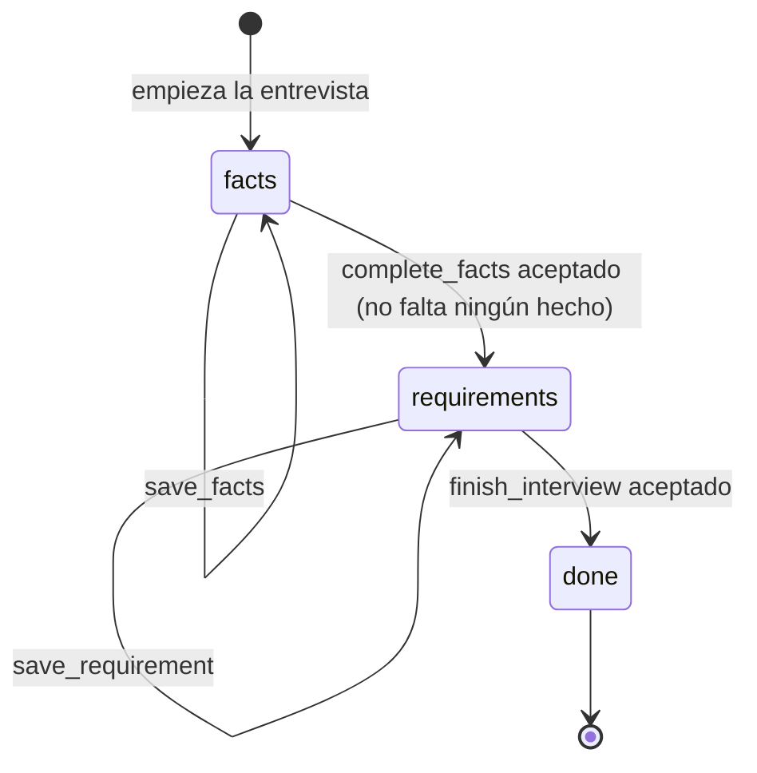

# Arquitectura de la entrevista de voz

Detalle de "La entrevista de voz" de `2-system-design.md`. Parte de Adolfo.

## Qué es

Una máquina de estados pequeña, escrita en nuestro código. Cada estado es un agente: un guion y
unas herramientas. El modelo lleva la conversación dentro de un estado; nuestro código decide
cuándo se pasa al siguiente.



| Estado | Agente | Guion | Herramientas disponibles |
|---|---|---|---|
| `facts` | Fase 1: qué ofreces | Conocer a la persona o la casa | `save_facts`, `complete_facts` |
| `requirements` | Fase 2: qué buscas | Qué pide al otro lado y si es imprescindible | `save_requirement`, `finish_interview` |
| `done` | Despedida | Se despide en una frase y la conversación se cierra | Ninguna |

Las fases no se pueden mezclar porque en cada estado el modelo solo tiene las herramientas de ese
estado. Una transición solo ocurre cuando nuestro código acepta la llamada que la pide.

## Cómo funciona una entrevista

1. El servidor pide a OpenAI una clave temporal (`POST /api/voice/session`) y se la da al navegador.
2. El navegador abre la conversación con la Realtime API por WebRTC y envía la configuración del
   estado `facts`: guion y herramientas.
3. La persona habla. Cuando el modelo quiere apuntar algo, emite una llamada a herramienta con sus
   argumentos en JSON.
4. Nuestro código valida los argumentos contra el contrato, actualiza el perfil y contesta al
   modelo qué ha guardado y qué falta. La pantalla enseña el campo relleno.
5. Cuando `complete_facts` se acepta, nuestro código envía a la misma conversación la
   configuración del estado `requirements` (`session.update`). No hay corte.
6. Cuando `finish_interview` se acepta, el perfil queda como `complete` y la conversación se cierra.

## Herramientas

| Estado | Herramienta | Argumentos | Qué hace nuestro código |
|---|---|---|---|
| `facts` | `save_facts` | Cualquier subconjunto de los hechos del rol, cada uno con su tipo | Valida y guarda; contesta qué hechos faltan |
| `facts` | `complete_facts` | Ninguno | Acepta solo si no falta ningún hecho; si no, contesta cuáles faltan |
| `requirements` | `save_requirement` | `field`, `operator`, `value`, `isMust` | Valida el campo (un hecho del otro rol) y el valor contra ese campo; un requisito por campo: el nuevo sustituye al anterior |
| `requirements` | `finish_interview` | `notes` | Guarda las notas y marca el perfil como `complete` |

`save_facts` recibe varios hechos a la vez: "gano 2.800, tengo contrato indefinido y no tengo
mascotas" es una sola llamada.

## Esquemas

Una sola fuente: `src/domain/profile.ts`. La definición de cada herramienta se genera a partir de
los esquemas zod del contrato, no se escribe a mano. Lo que zod genera añade `"type": "string"` a
los enumerados, un patrón a las fechas y, en `save_requirement`, limita `value` a texto, número,
booleano o lista de textos. Para un inquilino, `save_facts` queda así:

```json
{
  "type": "function",
  "name": "save_facts",
  "description": "Guarda uno o varios datos que la persona acaba de decir sobre sí misma.",
  "parameters": {
    "type": "object",
    "additionalProperties": false,
    "properties": {
      "monthlyIncomeEur": { "type": "number", "minimum": 0 },
      "employmentContract": { "enum": ["permanent", "temporary", "self_employed", "student", "unemployed"] },
      "occupants": { "type": "integer", "exclusiveMinimum": 0 },
      "hasPets": { "type": "boolean" },
      "smokes": { "type": "boolean" },
      "moveInDate": { "type": "string", "format": "date" },
      "stayMonths": { "type": "integer", "exclusiveMinimum": 0 }
    }
  }
}
```

`save_requirement`, donde `field` solo admite hechos del otro rol:

```json
{
  "type": "function",
  "name": "save_requirement",
  "description": "Guarda una condición que la persona pone sobre la casa.",
  "parameters": {
    "type": "object",
    "additionalProperties": false,
    "required": ["field", "operator", "value", "isMust"],
    "properties": {
      "field": { "enum": ["monthlyRentEur", "district", "rentalType", "bedrooms", "sizeM2", "furnished", "availableFrom"] },
      "operator": { "enum": ["eq", "lte", "gte", "in"] },
      "value": {},
      "isMust": { "type": "boolean" }
    }
  }
}
```

El tipo de `value` depende del campo, así que la definición lo deja abierto y lo valida nuestro
código. Aunque el modelo respete el esquema, todo vuelve a pasar por zod: la salida de un modelo es
entrada no fiable.

Lo que nuestro código contesta al modelo tras cada llamada:

```json
{ "ok": true, "saved": ["monthlyIncomeEur", "hasPets"], "missingFacts": ["occupants", "smokes", "moveInDate", "stayMonths"] }
```

```json
{ "ok": false, "error": "district must be one of: ciutat_vella, eixample, ...", "missingFacts": ["..."] }
```

## Salida estructurada

No hay un paso aparte. Los argumentos de las herramientas son la salida estructurada: llegan en
JSON, con esquema, durante la conversación. No se extrae nada de la transcripción al final.

## Guiones

Los construye una función según el rol y el estado, con la lista de campos sacada del contrato. Lo
que sigue son borradores para un inquilino; la versión que manda será la del código
(`src/interview/agents`). Para el casero cambian el rol, la lista de campos y la redacción.

Estado `facts`:

```text
# Rol
Eres la entrevistadora de una app de alquiler en Barcelona. Hablas con alguien
que busca piso. En esta parte solo quieres conocerle: quién es y cuál es su
situación.

# Tono
Cercana y breve. De tú. Una pregunta cada vez. Español de España.

# Datos que necesitas
- monthlyIncomeEur: ingresos netos al mes, en euros
- employmentContract: permanent, temporary, self_employed, student o unemployed
- occupants: cuántas personas vivirán en el piso
- hasPets: si tiene mascotas
- smokes: si fuma
- moveInDate: cuándo quiere entrar (hoy es {fecha})
- stayMonths: cuántos meses piensa quedarse

# Cómo
- Preséntate en una frase y pregunta por su situación en abierto.
- Cada vez que diga uno o varios datos, llama a save_facts con todos. No lo
  anuncies ni pidas permiso.
- La respuesta de la herramienta dice qué falta. Pregunta por lo siguiente.
- Si un dato es vago ("gano bien"), pide la cifra. No supongas nada.
- Si la herramienta devuelve un error, corrige o vuelve a preguntar.
- Cuando no falte nada, llama a complete_facts.

# Límites
- No preguntes ni apuntes nacionalidad, edad, género, hijos, religión ni salud.
  Si lo menciona, sigue sin comentarlo.
- No hables todavía de qué piso busca.
```

Estado `requirements`:

```text
# Rol
Ya conoces a la persona. Ahora averiguas qué busca en un piso.

# Sobre qué puede poner condiciones
- monthlyRentEur: alquiler máximo (lte)
- district: zonas que le valen (in), de esta lista: {distritos}
- rentalType: piso entero o habitación (eq)
- bedrooms: habitaciones mínimas (gte)
- sizeM2: metros mínimos (gte)
- furnished: amueblado o no (eq)
- availableFrom: disponible como tarde en una fecha (lte)

# Cómo
- Pregunta en abierto qué es importante para él o ella.
- Por cada cosa, conviértela en campo, operador y valor. Pregunta "¿es
  imprescindible o lo prefieres?", salvo que ya lo haya dejado claro. Después
  llama a save_requirement.
- Si dice "cerca de mi universidad", pregunta qué zonas le valen.
- Lo que no encaje en ningún campo, guárdalo para las notas.
- Cuando no tenga más, pregunta "¿quieres añadir algo?" y llama a
  finish_interview con las notas.

# Límites
- No preguntes ni apuntes nacionalidad, edad, género, hijos, religión ni salud.
```

## Comprobado con la API real (2026-11-21)

- Clave temporal: `POST https://api.openai.com/v1/realtime/client_secrets`; la clave viene en `value`.
- Conexión del navegador: oferta SDP a `https://api.openai.com/v1/realtime/calls` con la clave
  temporal; canal de datos `oai-events`.
- Las llamadas a herramientas llegan en el evento `response.done`, como elementos `function_call`
  de `response.output`. Se contestan con `conversation.item.create` (`function_call_output`) y
  después `response.create`.
- `session.update` cambia guion y herramientas a mitad de conversación: el relevo funciona.
- El modelo `gpt-realtime-2.1` existe y acepta las definiciones que genera zod, incluida la
  expresión regular de las fechas.
- Hay un tercer estado de configuración, `done`: sin herramientas, solo se despide.

## Por comprobar

- La entrevista hablando por el micrófono en el navegador. En modo texto funciona de principio a
  fin para los dos roles.
- La documentación de OpenAI recomienda ahora otro producto, GPT-Live (`gpt-live-1.1`), para voz
  en el navegador. Seguimos con la Realtime API, que sigue documentada y funciona.
